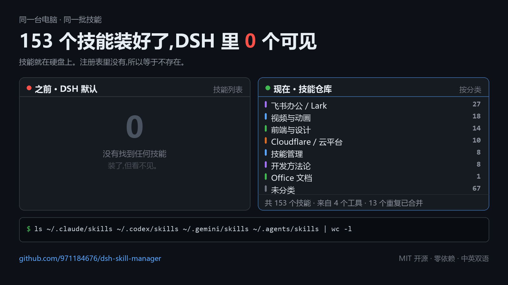
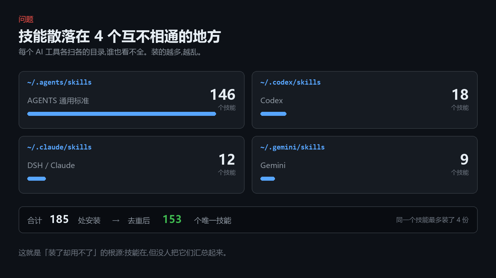
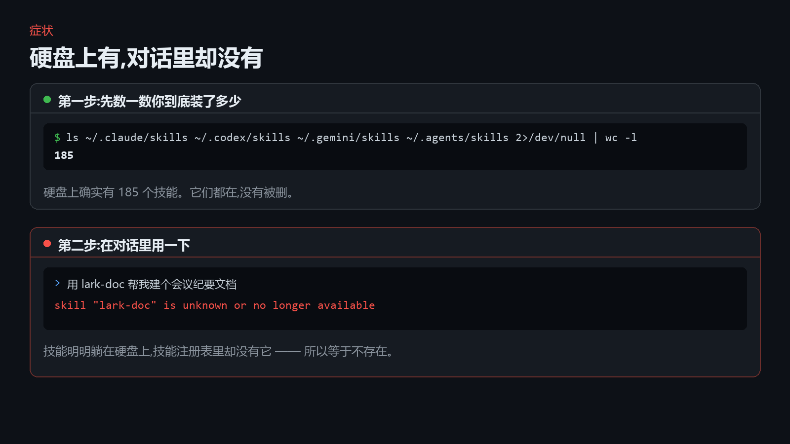
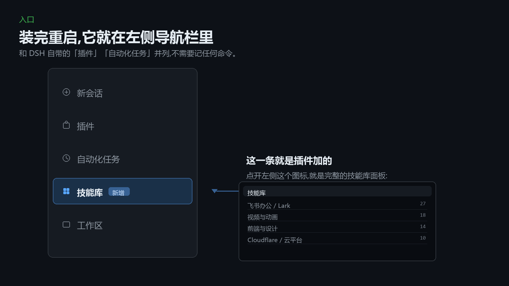
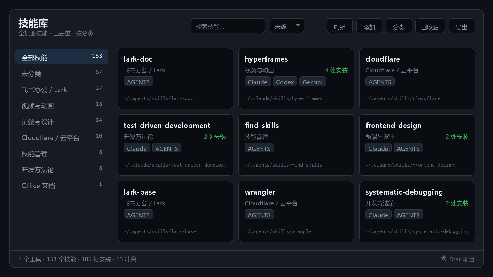
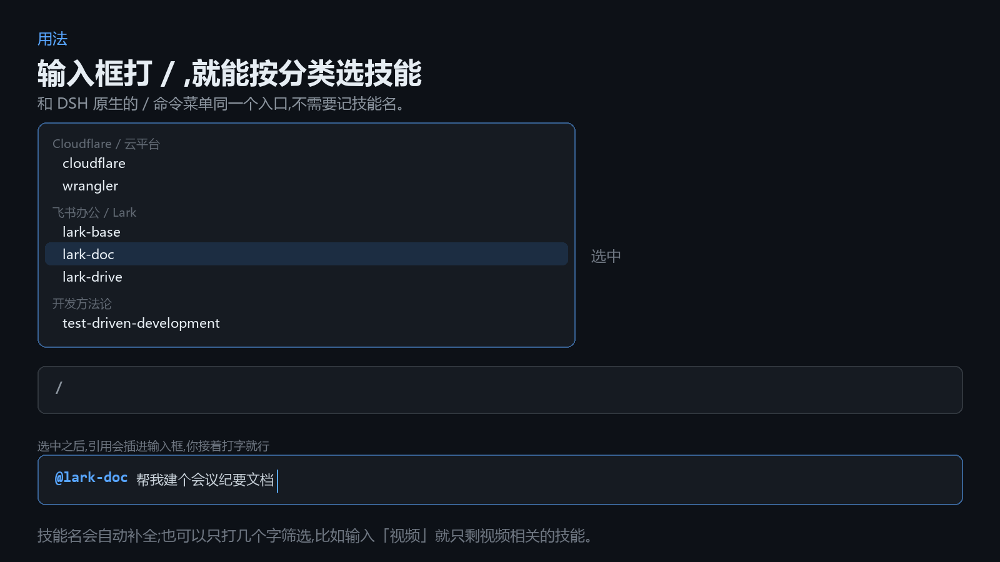

# 我电脑上装了 153 个 AI 技能,DeepSeek Harness 里一个都看不到



先说结论:技能不是没装,是**没有任何一个工具把它们汇总起来**。

---

## 一、问题:技能散在 4 个互不相通的地方



如果你同时用 Claude Code、Codex、Gemini 和 DeepSeek Harness,你的技能大概散在这几个目录里:

| 目录 | 技能数 |
|---|---|
| `~/.agents/skills` | 146 |
| `~/.codex/skills` | 18 |
| `~/.claude/skills` | 12 |
| `~/.gemini/skills` | 9 |

*(上面的数字是我这台机器上的真实统计)*

每个工具各扫各的目录,于是出现了三个很烦的后果:

**1. 同一个技能装了好几遍。** 我这台机器上有 13 个技能在多个工具里各存了一份,其中 `hyperframes` 一个技能装了 **4 份**——Claude、Codex、Gemini、AGENTS 目录里各一份。

**2. 你根本不知道自己装了什么。** 除了一个个文件夹翻,没有别的办法。时间一长,忘了装过什么,于是又去下载一遍。

**3. 想删又不敢删。** 删掉某一个工具目录里那份,另一个工具可能就用不了了——而且你很难确认到底哪个目录对应哪个工具。

合计下来是 **185 处安装**,去重之后是 **153 个唯一技能**。

---

## 二、症状:硬盘上有,对话里却没有



先自查一下,不装任何东西也能跑:

```bash
ls ~/.claude/skills ~/.codex/skills ~/.gemini/skills ~/.agents/skills 2>/dev/null | wc -l
```

我这边输出是 `185`。

但如果你在对话里让 Agent 用某个技能,它很可能是这么回你的:

```
skill "lark-doc" is unknown or no longer available
```

技能明明躺在硬盘上,一个字都没少。

原因是:DSH 通过一个**技能注册表**来决定「当前有哪些技能可用」,而注册表只收录了一部分目录来源。没被收录的技能,对 DSH 来说就等于不存在——你能在文件管理器里看到它,但对话里用不了,面板里也看不到。

---

## 三、所以我写了个插件



装完重启之后,**左侧导航栏会直接多出一条「技能库」**,和 DSH 自带的「插件」「自动化任务」并列。点一下那个图标,就是完整的技能库面板——不需要记任何命令,也不需要额外的启动步骤。

这个插件主要做了三件事。

### 1. 全机器扫描 + 按 name 合并去重

一次扫完 Claude、Codex、Gemini、AGENTS 以及 DSH 内置目录。同名技能合并成**一条记录**,下挂全部安装位置——前面那个装了 4 份的 `hyperframes`,现在只显示一条,标注「4 处安装」。想清理的时候,你能清楚看到每个工具里各有一份。

### 2. 把技能重新接回注册表

插件自己注册一个技能提供者,把扫描到的技能喂进注册表。这样原本「装了却调不了」的技能,**在对话里又能用了**。这一步不依赖 DSH 自带的技能提供者是否启用。

### 3. 一个能真正管起来的面板



侧边栏入口,包含:

- 分类侧栏 + 技能列表 + 详情抽屉
- 搜索,以及按来源工具筛选
- 安全删除——先进回收站,可恢复;只读来源自动保护
- 从本地文件夹或 Git 仓库安装
- 导出 Markdown / CSV / JSON 清单
- 自定义分类、别名、收藏
- **合集**:把几个常用技能存成一个自定义合集,侧边栏点一下就调出来;一个技能可以同属多个合集
- **自由改归类**:AI 自动分类不准的,点卡片上的分类标签就能直接移到别的分类,支持勾选多个技能批量移动,也能当场新建一个分类

---

## 四、怎么用:输入框打一个 `/`



在输入框打一个 `/`,技能列表就出来了,**按分类分组**。它和 DSH 原生的命令菜单是同一个入口,所以不需要记任何技能名。

选中之后,引用会插进输入框:

```
@lark-doc 帮我建个会议纪要文档
```

你接着把话说完,回车发送就行。

列表还支持筛选:只打几个字,比如输入「视频」,列表里就只剩视频相关的技能。

---

## 五、安装

**第一步**,克隆仓库:

```bash
git clone https://github.com/971184676/dsh-skill-manager.git
```

**第二步**,在 `~/.dsh/profiles/<你的 profile>/package.json` 里加两处:

```jsonc
{
  "dsh": { "profile": { "bundles": [ "…", "@local/skill-manager" ] } },
  "dependencies": { "@local/skill-manager": "link:/绝对路径/skill-manager" }
}
```

**第三步**,在同一个 profile 的 `cordis.patch.yml` 里加一行:

```yaml
- insert:
    - id: skill-manager
      name: '@local/skill-manager'
      config: {}
```

**第四步**,重启 DSH。左侧导航栏出现「技能库」,位置就在「插件」和「自动化任务」下面。

> 前提条件:已安装 [DeepSeek Harness](https://github.com/deepseek-ai) `0.2.0-rc.2` 或更新版本。
> 也可以在 DSH 里直接让 Agent 帮你装(仓库 README 里有说明)。

---

## 六、一些补充

- **MIT 开源**,零外部依赖——只用 Node 内置模块和 DSH 官方的 peerDependencies
- 界面**中英双语**,导出清单同样双语
- **安全设计**:路径穿越防护、命令注入防护、删除进回收站、只读源保护、扫描深度与体积上限
- **有测试和 CI**:21 项单元测试(零依赖,`npm test` 直接跑)+ 每次提交自动检查依赖完整性
- 如果遇到「技能看不见」的其他情况,仓库里的 `docs/TROUBLESHOOTING.md` 按 **4 个独立断点**分别给了判断方法和解法

---

**仓库地址:** https://github.com/971184676/dsh-skill-manager

如果你也遇到过「技能装了却用不了」,这个插件应该能帮你省点时间。觉得有用的话,欢迎点个 ⭐ Star。
